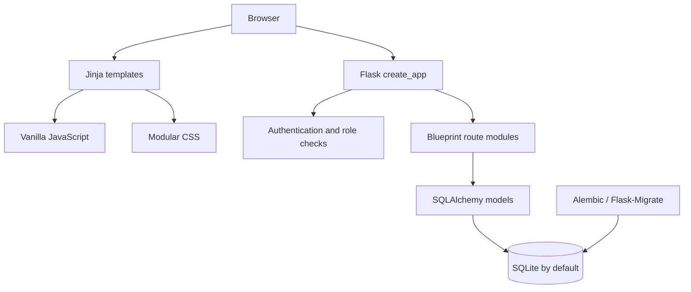
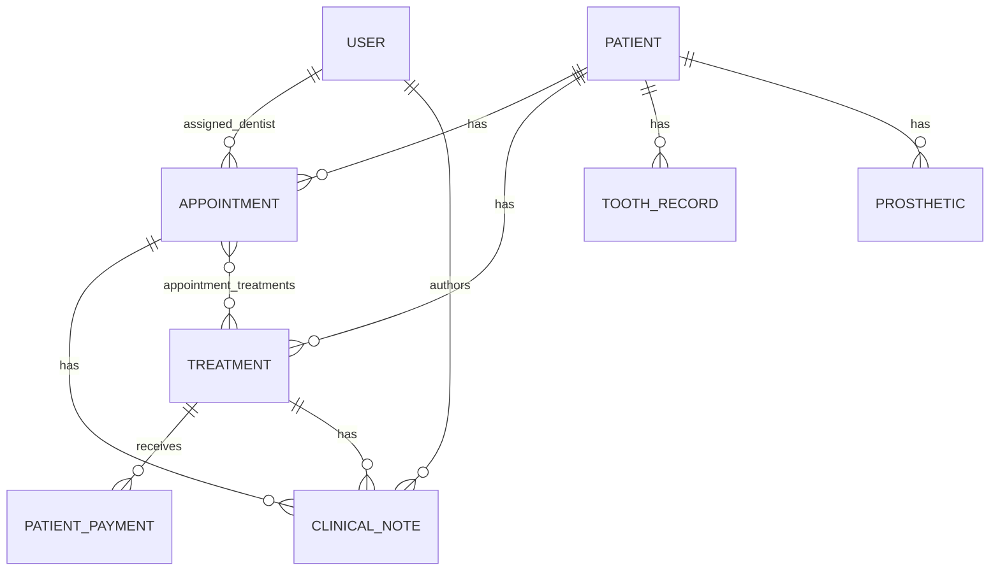

# Dental App — Application Map

**Last reviewed:** 2026-11-17**Source:** Static inspection of the supplied `dental_app_audit.zip`.**Purpose:** A practical map of the Flask application: startup, modules, routes, templates, frontend assets, data models and critical workflows.

> This document describes the supplied source snapshot. It is not a runtime trace, deployment diagram or proof that every route is secure/correct. See `AUDIT_REPORT.md` for findings and `ROADMAP.md` for remediation work.

## 1. High-level architecture

The frontend is server-rendered with Jinja and enhanced by page-specific vanilla JavaScript. Flask blueprints expose HTML pages and JSON endpoints. Route modules use SQLAlchemy models to read/write the database.

## 2. Startup and application construction

| File                  | Responsibility                                                                                                                                                                         |
| --------------------- | -------------------------------------------------------------------------------------------------------------------------------------------------------------------------------------- |
| `wsgi.py`           | WSGI entry point; constructs the Flask app.                                                                                                                                            |
| `app/__init__.py`   | `create_app`, CSRF, extension initialization, blueprint registration, context processor, logging and `init-db` CLI command.                                                        |
| `app/config.py`     | Loads root `.env`; requires `SECRET_KEY`, `ADMIN_USERNAME`, `ADMIN_PASSWORD`; selects `DATABASE_URL` or default `app/instance/patients.db`; defines `DevelopmentConfig`. |
| `app/extensions.py` | Shared Flask extension objects.                                                                                                                                                        |
| `app/database.py`   | Database initialization/seed helpers (inspect before using; startup/database operations can affect configured DB).                                                                     |
| `app/enums.py`      | Roles, appointment/treatment statuses, tooth states, categories and financial enums.                                                                                                   |
| `app/models.py`     | SQLAlchemy schema and relationships.                                                                                                                                                   |
| `migrations/`       | Alembic migration history.                                                                                                                                                             |

### Application factory sequence

1. Create Flask app and configure instance path.
2. Load selected config object.
3. Enable Flask-WTF CSRF protection.
4. Create/configure instance folder.
5. Initialize SQLAlchemy, LoginManager, Flask-Migrate and CORS.
6. Register auth, patient, calendar, dashboard, appointment, finance and settings blueprints.
7. Register `init-db` CLI command.
8. Configure application/file logging and enum context processor.

**Safety note:** Do not launch/import this app against the clinic database during static inspection. `init-db` invokes `db.create_all()` and may seed an administrator using configured credentials. `configure_instance_folder` currently attempts broad permissions on Windows; see audit/roadmap.

## 3. Blueprint and route map

Blueprints are registered in `app/__init__.py`.

### Authentication — `app/auth/routes.py`

| Endpoint / function       | Methods   | Purpose                                                         |
| ------------------------- | --------- | --------------------------------------------------------------- |
| `/login` — `login`   | GET, POST | Login form and authentication.                                  |
| `/logout` — `logout` | POST      | Logout with CSRF protection (changed from GET on 2026-11-18).|  |
| `role_required(*roles)` | decorator | Role gate for routes.                                           |

### Patients and clinical records — `app/routes/patient.py`

| Route pattern                                              | Methods           | Function / purpose                  |
| ---------------------------------------------------------- | ----------------- | ----------------------------------- |
| `/patients/`                                             | GET               | Patient list/home.                  |
| `/patients/<patient_id>`                                 | GET               | Redirect/root patient route.        |
| `/patients/add`                                          | GET, POST         | Add patient.                        |
| `/patients/<patient_id>/profile`                         | GET               | Patient profile.                    |
| `/patients/<id>/edit`                                    | GET               | Edit form.                          |
| `/patients/<id>/update`                                  | POST              | Update patient.                     |
| `/patients/<id>/delete`                                  | POST              | Delete patient.                     |
| `/patients/<patient_id>/treatments`                      | GET               | Treatment plan.                     |
| `/patients/<patient_id>/treatments/add`                  | POST              | Add treatment.                      |
| `/patients/treatments/<treatment_id>/update-status`      | POST              | Change treatment status.            |
| `/patients/treatments/<treatment_id>/delete`             | POST              | Delete treatment.                   |
| `/patients/<patient_id>/financial`                       | GET               | Patient financial ledger.           |
| `/patients/<patient_id>/financial/add-payment`           | POST              | Add patient payment.                |
| `/patients/<patient_id>/financial-summary`               | GET               | Financial summary.                  |
| `/patients/<patient_id>/outstanding-treatments`          | GET               | Outstanding treatments.             |
| `/patients/<patient_id>/documents`                       | GET               | Patient documents page/placeholder. |
| `/patients/<patient_id>/teeth-chart`                     | GET               | Odontogram page.                    |
| `/patients/<patient_id>/api/teeth-chart`                 | GET, POST, DELETE | Read/save/reset tooth records.      |
| `/patients/<patient_id>/api/prosthetics`                 | GET, POST, DELETE | Read/create/delete prosthetics.     |
| `/patients/<patient_id>/api/prosthetics/<prosthetic_id>` | DELETE            | Delete one prosthetic.              |
| `/patients/<patient_id>/clinical-log`                    | GET               | Clinical log.                       |
| `/patients/<patient_id>/api/details`                     | GET               | Patient details JSON.               |
| `/patients/treatments/<treatment_id>/update-notes`       | POST              | Add/update treatment notes.         |
| `/patients/treatments/<treatment_id>/mark-complete`      | POST              | Mark treatment complete.            |

### Calendar and appointment scheduling — `app/routes/calendar.py`

| Route pattern                                 | Methods | Function / purpose                               |
| --------------------------------------------- | ------- | ------------------------------------------------ |
| `/calendar`                                 | GET     | Calendar page.                                   |
| `/health`                                   | GET     | Health check.                                    |
| `/appointments`                             | GET     | Appointment feed/list JSON.                      |
| `/appointments`                             | POST    | Create appointment and associate treatments.     |
| `/catalog/search`                           | GET     | Search active treatment catalog.                 |
| `/patients/<patient_id>/planned-treatments` | GET     | Fetch candidate treatments for scheduling.       |
| `/appointments/<appointment_id>`            | PUT     | Edit appointment and treatment associations.     |
| `/appointments/<appointment_id>/cancel`     | POST    | Cancel appointment.                              |
| `/appointments/<appointment_id>/complete`   | POST    | Complete appointment.                            |
| `/appointments/<appointment_id>`            | GET     | Read appointment details; must remain read-only. |
| `/patients/search`                          | GET     | Search patients for calendar UI.                 |

### Appointment list and deletion — `app/routes/appointment.py`

| Route pattern                                  | Methods | Function / purpose                     |
| ---------------------------------------------- | ------- | -------------------------------------- |
| `/appointments/`                             | GET     | Appointment list page.                 |
| `/appointments/cancel/<appointment_id>`      | POST    | Appointment cancellation path.         |
| `/appointments/bulk_hard_delete`             | POST    | Bulk hard delete. Intended admin-only. |
| `/appointments/hard_delete/<appointment_id>` | POST    | Hard delete. Intended admin-only.      |

### Dashboard — `app/routes/dashboard.py`

| Route pattern  | Methods | Function / purpose |
| -------------- | ------- | ------------------ |
| `/dashboard` | GET     | Main dashboard.    |

### Clinic finance — `app/routes/finance.py`

| Route pattern                                       | Methods   | Function / purpose         |
| --------------------------------------------------- | --------- | -------------------------- |
| `/finance`                                        | GET       | Finance dashboard.         |
| `/api/finance/dashboard`                          | GET       | Dashboard aggregates.      |
| `/api/finance/update-balance`                     | POST      | Update balance.            |
| `/api/finance/cash-balance`                       | POST      | Record cash/bank balance.  |
| `/api/finance/income`                             | GET, POST | List/save daily income.    |
| `/api/finance/income/<record_id>`                 | DELETE    | Delete income record.      |
| `/api/finance/expenses`                           | GET, POST | List/save expenses.        |
| `/api/finance/expenses/<exp_id>`                  | DELETE    | Delete expense.            |
| `/api/finance/expenses/<exp_id>/payment`          | POST      | Add expense payment.       |
| `/api/finance/expenses/<exp_id>/payment/<pay_id>` | DELETE    | Delete expense payment.    |
| `/api/finance/monthly-summary`                    | GET       | Monthly financial summary. |
| `/api/finance/save-draw`                          | POST      | Save owner draw.           |

### Settings — `app/routes/settings.py`

| Route pattern                          | Methods | Function / purpose                |
| -------------------------------------- | ------- | --------------------------------- |
| `/settings/users`                    | GET     | User management page.             |
| `/settings/users/add`                | POST    | Create user.                      |
| `/settings/users/<user_id>/delete`   | POST    | Delete user.                      |
| `/settings/catalog`                  | GET     | Treatment catalog page.           |
| `/settings/catalog/save`             | POST    | Create/update catalog item.       |
| `/settings/catalog/<item_id>/toggle` | POST    | Toggle catalog item active state. |

## 4. Template-to-page map

| Template                                  | Page / feature                     |
| ----------------------------------------- | ---------------------------------- |
| `templates/base.html`                   | Global layout/navigation.          |
| `templates/auth/login.html`             | Login.                             |
| `templates/dashboard/home.html`         | Main dashboard.                    |
| `templates/appointment/list.html`       | Appointment list.                  |
| `templates/calendar/dashboard.html`     | Calendar.                          |
| `templates/patient/list.html`           | Patient list.                      |
| `templates/patient/profile.html`        | Patient profile.                   |
| `templates/patient/edit.html`           | Patient edit.                      |
| `templates/patient/patient_base.html`   | Patient section layout/navigation. |
| `templates/patient/treatments.html`     | Treatment plan.                    |
| `templates/patient/teeth_chart.html`    | Odontogram and prosthetics.        |
| `templates/patient/clinical_log.html`   | Clinical notes/log.                |
| `templates/patient/financial.html`      | Patient payments/ledger.           |
| `templates/finance/dashboard.html`      | Clinic finance.                    |
| `templates/settings/settings_base.html` | Settings layout.                   |
| `templates/settings/users.html`         | User management.                   |
| `templates/settings/catalog.html`       | Treatment catalog.                 |

## 5. Frontend asset map

### JavaScript

| File                             | Responsibility                         |
| -------------------------------- | -------------------------------------- |
| `js/appointment/list.js`       | Appointment list interactions.         |
| `js/calendar/main.js`          | Calendar initialization/orchestration. |
| `js/calendar/state.js`         | Calendar client state.                 |
| `js/calendar/API.js`           | Calendar HTTP/API calls.               |
| `js/calendar/CalRender.js`     | Calendar rendering.                    |
| `js/calendar/eventHandlers.js` | Calendar form/event handlers.          |
| `js/calendar/interaction.js`   | Calendar interactions.                 |
| `js/calendar/helper.js`        | Calendar helper functions.             |
| `js/patient/treatments.js`     | Treatment plan interactions.           |
| `js/patient/teeth_chart.js`    | Odontogram/prosthetic interactions.    |
| `js/patient/clinical_log.js`   | Clinical log interactions/rendering.   |
| `js/patient/financial.js`      | Patient financial UI.                  |
| `js/finance/dashboard.js`      | Clinic finance dashboard UI.           |
| `js/settings/catalog.js`       | Catalog form/edit/search interactions. |
| `js/settings/settings.js`      | Settings interactions.                 |

### CSS

- `css/style.css` is the global stylesheet entry point.
- `css/base/`: reset and design variables.
- `css/components/`: alerts, buttons, forms and tables.
- `css/layout/`: navigation, page header, patient navigation, responsive rules and overall structure.
- `css/pages/`: page-specific styles for appointment list, calendar, dashboard, patient views, settings and clinical/financial pages.

## 6. Data model and relationships

### Core clinical model

### Model inventory

| Model / table                                | Purpose                                   | Important links/fields                                                    |
| -------------------------------------------- | ----------------------------------------- | ------------------------------------------------------------------------- |
| `User` / `user`                          | Login identity and role.                  | username, password hash, role, name.                                      |
| `Patient` / `patient`                    | Demographics and medical context.         | created_by, credit_balance, allergies, medical_history, notes.            |
| `Appointment` / `appointments`           | Booked visit.                             | patient_id, dentist_id, start/end, status, completed_at, deleted_at.      |
| `Treatment` / `treatment`                | Patient-specific clinical procedure.      | patient_id, tooth_number, cost, status, clinical notes, insurance amount. |
| `appointment_treatments`                   | Many-to-many association.                 | appointment_id + treatment_id composite primary key.                      |
| `TreatmentCatalog` / `treatment_catalog` | Reusable procedure catalog.               | name, category, code, cotation, default_price, target_type, is_active.    |
| `PatientPayment` / `patient_payment`     | Patient payment allocated to a treatment. | treatment_id, amount, date, method.                                       |
| `ToothRecord` / `tooth_record`           | Per-patient tooth state.                  | patient_id, tooth_number, state.                                          |
| `Prosthetic` / `prosthetic`              | Prosthetic work/structure.                | patient_id, type, start_tooth, end_tooth.                                 |
| `ClinicalNote` / `clinical_note`         | Clinical note with optional links.        | content, treatment_id, appointment_id, author_id.                         |
| `DailyIncome` / `daily_income`           | Daily income summary.                     | date, month, day_type, num_patients, amount.                              |
| `Expense` / `expense`                    | Clinic expense.                           | date, category, supplier, total_amount, VAT.                              |
| `Payment` / `payment`                    | Payment toward an expense.                | expense_id, date, amount.                                                 |
| `LabWork` / `lab_work`                   | External lab cost/billing tracking.       | record_id, patient_name, procedure, costs, billed/collected amounts.      |
| `CashBalance` / `cash_balance`           | Cash and bank balances.                   | date, cash_on_hand, bank_account.                                         |
| `OwnerDraw` / `owner_draw`               | Owner withdrawals.                        | month, amount.                                                            |

## 7. Critical business workflows

### Patient and clinical workflow

1. Patient is created/updated.
2. Dentist/authorized clinical user views patient profile.
3. Tooth records are updated using FDI numbering.
4. Treatments are created against the patient and optionally a tooth.
5. Clinical notes may be linked to a treatment and/or appointment.
6. Prosthetic records describe patient-specific work.

### Treatment scheduling workflow

1. A treatment begins in `planned`.
2. A user books an appointment for the same patient and selects one or more treatments.
3. When linked to an active `scheduled` appointment, a `planned` treatment transitions to `scheduled`.
4. A treatment already `in_progress` remains `in_progress`.
5. A treatment can be associated with multiple appointments for multi-visit care.
6. On unlink/cancellation, reconcile against all other active appointment links. Only revert `scheduled` to `planned` if no active (`scheduled` or `in_progress`) appointment remains.
7. Appointment completion is not automatically treatment completion. Clinical completion is recorded per treatment; a multi-visit treatment may remain `in_progress`.
8. GET endpoints never mutate state.

### Financial workflow

- Patient payments are attached to treatments via `PatientPayment`.
- Patient financial views aggregate treatment charges and patient payments.
- Clinic finance tracks `DailyIncome`, `Expense`, expense `Payment`, `LabWork`, `CashBalance` and `OwnerDraw`.
- All monetary calculations must use `Decimal`; ownership and allocation must be validated server-side.
- Patient credit semantics need one documented authoritative invariant; see `ROADMAP.md` DATA-001.

## 8. Security and operational boundaries

- CSRF protection is initialized globally in the app factory.
- Login is managed by Flask-Login; role checks use `role_required` in auth routes.
- All patient/treatment/appointment/payment IDs from the browser are untrusted and require ownership/relationship checks.
- `DevelopmentConfig` currently sets DEBUG and SQL echo on; do not treat it as production configuration.
- Logs are written to `appointments.log`; inspect for sensitive payloads and configure redaction/retention.
- CORS is initialized; review whether it is needed and restrict origins.
- Do not include `.env`, instance DB files, backups, logs or patient exports in audit archives or Git.

## 9. Static audit limitations

The map is based on source files in the supplied archive. The audit did not launch the app against the clinic database, execute end-to-end browser workflows, inspect live patient data, perform penetration testing, or verify production infrastructure. Automated tests were not present in the supplied snapshot. Treat route behavior and security conclusions as static findings pending isolated runtime verification.
